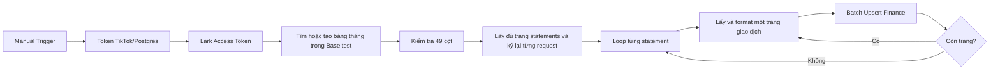

# Chuyển workflow TikTok Finance sang community node

Tool trong repository chuyển workflow đã xuất từ n8n sang bản test dùng package `@vutiendung/n8n-nodes-lark-base@0.4.0`. Không thay code/runtime, version hoặc dependencies của package. Tool không gọi mạng, không ghi vào Lark hoặc kích hoạt workflow trên server.

## Tạo file import

Chạy trong thư mục repository, truyền đường dẫn file JSON nguồn:

```powershell
node scripts/migrate-tiktok-finance.mjs "C:/path/to/source-workflow.json"
```

Kết quả mặc định: `.n8n/tiktok-finance-community-test.workflow.json`. Có thể dùng file Pasted text.txt chứa JSON làm đầu vào. Bản riêng cho workflow đính kèm đã được tạo tại đường dẫn mặc định này. File giữ các node giải mã/ký/refresh TikTok và credential reference Postgres của workflow nguồn; vì nguồn chứa bí mật TikTok, không commit/chia sẻ file JSON này. `.n8n/` đã được Git bỏ qua và không nằm trong npm files. Fixture trong tests chỉ chứa schema, formatter, helper ký và code ngày, không chứa node cấu hình bí mật.

## Import và chạy thử

1. Cài `@vutiendung/n8n-nodes-lark-base@0.4.0` và `n8n-nodes-hmac@1.0.0` trên n8n, import JSON thành workflow mới.
2. Tại **Lark Access Token**, chọn credential **Lark API (Vutiendung)** được cấp quyền tạo/quản lý bảng và đọc/ghi toàn bộ Base test `Df3WbKnmyaeUKJsphablcI8Jgeh`. Postgres tiếp tục dùng credential của workflow gốc; chọn lại nếu import sang instance khác. Tạo credential **HMAC API**, nhập TikTok **App Secret** vào ô **API Key**, chọn cùng credential này tại `TikTok Get Shops HTTP`, `1. Get Statments`, `Get Transaction By Statement` (nay đều là HMAC Request).
3. Chạy **Chạy thử thủ công**. Workflow ở trạng thái inactive, Schedule Trigger bị disable và không có pinned data.
4. Nhánh Lark duyệt đủ danh sách bảng. Nếu chưa có `Finance_YYYY_MM`, tạo bảng với 49 cột từ schema gốc: khóa `ID định danh (TTS)` là Text, 2 DateTime, 39 Currency/VND, 7 Text còn lại. Ví dụ tháng 10/2026 là `Finance_2026_10`. Chỉ tạo bảng cho tháng đang chạy, không tạo sẵn 12 bảng.
5. Duyệt đủ metadata cột, dừng nếu thiếu/sai kiểu hoặc sai Currency/VND. Với bảng đã tồn tại, workflow kiểm tra schema và không tự sửa/xóa cột. Nếu có hai bảng cùng tên, dừng để tránh chọn nhầm.
6. Đọc TikTok, chạy từng statement/trang tuần tự rồi **Batch Upsert Finance** bằng khóa `ID định danh (TTS)`. Có rồi cập nhật; chưa có mới tạo; duplicate/lookup lỗi dừng.
7. Khi có statement, **Finance Result** trả Base/Table và tổng created/updated. Nếu không có statement SETTLED trong khoảng ngày thì không ghi record và nhánh kết thúc không có item; bảng có thể đã được tạo ở bước setup.

Hiện không có kết nối Lark/n8n trực tiếp trong phiên làm việc: bảng chỉ được tạo khi chạy workflow trên n8n có credential phù hợp. Không xem file import là bằng chứng bảng đã được tạo hoặc TikTok thật đã đồng bộ.

## Những thay đổi trong luồng



- Bỏ Search Order Lark, Update OR Create F, các HTTP Batch Create/Update và Merge hai nhánh ghi. Bản cũ chọn một record khi Lark có nhiều kết quả cùng khóa; community node dừng khi duplicate.
- Không gom finance bằng workflow static data, không Clear Global hoặc đưa toàn bộ static data ra output. State cursor/key/count đi theo item trong execution; không xóa dữ liệu của execution khác.
- Lấy đủ trang statements trước khi loop, không dùng mỗi statement đầu tiên. Mỗi trang TikTok tạo lại chữ ký HMAC có page_token; không dùng pagination HTTP tự thêm cursor mà giữ chữ ký cũ.
- Code node chỉ chuẩn bị path/params/message chưa ký, không import `crypto`. `n8n-nodes-hmac` tạo HMAC-SHA256 và gửi request bằng Custom Pattern đã bọc App Secret theo quy tắc TikTok. `Include Timestamp` phải tắt vì timestamp đã nằm trong params khi chuẩn bị message. Query Parameters/Headers là expression trả object, không phải JSON string. Các node giữ nguyên tên để reference và loop không đổi.
- Nếu API trả nhiều shop đã cấp quyền, chọn đúng shop_id khớp dòng token Postgres thay vì lấy shop đầu tiên. Thiếu/trùng shop đích gây lỗi trước khi đọc finance.
- Trang giao dịch rỗng vẫn đi qua nhánh điều khiển để đọc trang tiếp/statement tiếp. Sau Batch Upsert, mọi record output được gom thành một item điều khiển, không nhân số lần lặp theo số record.
- Khóa giữ cách ghép `transaction_id + '_' + shop_id` của nguồn. ID phải là chuỗi; khóa lặp trong một statement bị chặn. Mapping cột và cách lấy thành phần tiền từ nguồn được giữ. Số âm và 0 không bị loại; tiền sai định dạng gây lỗi thay vì đổi thành null/0. Tên `Mã statemen` giữ nguyên để khớp nguồn.
- Token Lark lấy qua credential n8n; Base node dùng token đó. Các HTTP còn lại chỉ bootstrap/list metadata; record ghi bằng community node. Token hết hạn giữa execution cần chạy lại node token/workflow.
- Refresh TikTok vẫn cập nhật Postgres rồi dừng bằng Stop and Error như bản gốc; chạy lại workflow sau khi refresh thành công. Không in nguyên response refresh vào error vì có thể chứa token.

## Hosting chặn module crypto trong Code node

File đã chuyển phần ký sang gói có sẵn `n8n-nodes-hmac@1.0.0`; không cần mở allowlist module hoặc thêm code HMAC tự viết. Không dùng Crypto built-in trong bản workflow này. Sau khi nhập lại file, phải chọn credential HMAC API ở cả ba request; API Key của credential phải bằng App Secret đang có trong nhánh Get Token Tiktok để key và Custom Pattern khớp nhau.

Nhánh TikTok từ nguồn cũng có giải mã/mã hóa AES-256-CBC bằng `require('crypto')`. Nhánh này được khôi phục theo yêu cầu rồi đổi sang các Postgres query có tham số dùng `extensions.decrypt_iv`, `encrypt_iv`, `gen_random_bytes` trên Supabase. Giữ định dạng token `v1:<iv-base64>:<ciphertext-base64>`, key 32 byte và padding tương thích nguồn; không đổi dữ liệu token đang lưu. `Check TikTok pgcrypto`/`Confirm TikTok pgcrypto` kiểm tra các hàm cần thiết trước khi đọc token; tool không tự cài extension hay thay schema database. Nếu thiếu, bật pgcrypto trong Supabase Database → Extensions tại schema extensions và cấp quyền phù hợp. Chưa kết nối Supabase thật để xác minh extension/quyền/giải mã trong phiên này.

App Key/App Secret/key AES từ cấu hình nguồn vẫn nằm trong workflow riêng và nhánh Get Token trả App Secret như bản gốc để xây message TikTok; gói HMAC không loại bỏ bí mật đã có trong workflow/history. Không đưa file này vào Git/npm hoặc chia sẻ output token. Chỉ credential Lark và HMAC API được n8n quản lý qua credential store.

Vá file hiện tại mà giữ các chỉnh sửa/credential của người dùng, đồng thời lấy lại nhánh TikTok đã xóa từ file nguồn:

```powershell
node scripts/migrate-tiktok-finance.mjs --community-hmac .n8n/tiktok-finance-community-test.workflow.json "C:/path/to/original-workflow.json"
```

Backup lần đầu ở cạnh file với đuôi `.before-community-hmac.bak`, cũng thuộc `.n8n/` được bỏ qua bởi Git. Nếu nhánh TikTok chưa bị xóa và không cần khôi phục, bỏ đối số nguồn cuối. Lệnh không gọi TikTok, Supabase hay Lark.

## Phạm vi và giới hạn

Giữ cửa sổ ngày của node Month gốc: lấy ngày lịch Việt Nam rồi truy vấn ngày UTC tương ứng, từ 00:00:01 tới ngày tiếp theo 00:00:01, lọc SETTLED trong khoảng UTC bỏ offset 1 giây. Đây không phải truy vấn cả tháng hoặc backfill. Bảng được chia thêm năm để không gộp tháng của nhiều năm. Muốn đổi lịch sử/ngày truy vấn cần chỉnh Month trước khi chạy; không tự đổi kỳ tài chính trong lần chuyển đổi này.

Một statement có nhiều trang có thể ghi thành công trang đầu trước khi trang sau lỗi; không có transaction toàn workflow. Batch Upsert kiểm tra toàn input của trang hiện tại trước ghi và có thể cập nhật lại các cột được nguồn gửi dù giá trị không đổi. Vì vậy khác bản so diff cũ ở việc không bỏ qua dòng unchanged; có thể kích hoạt automation phía Lark. Không bật Retry On Fail/Continue On Fail cho node ghi. Chạy một writer cho cùng business key; không chạy bản test và bản gốc cùng target. Giới hạn cursor nội bộ là 1.000 trang mỗi danh sách; chưa xác minh dữ liệu/permission tenant thật.

Schema bootstrap theo hợp đồng `table.name/default_view_name/fields` và response `data.table_id` của [SDK Lark chính thức](https://github.com/larksuite/oapi-sdk-go/blob/db9f52d0a88e3f5e4ed81bb34d71a28e3f5608fa/service/bitable/v1/model.go), [API tạo bảng](https://open.feishu.cn/document/server-docs/docs/bitable-v1/app-table/create). Các endpoint TikTok giữ từ workflow nguồn; xem [Get Statements](https://partner.tiktokshop.com/docv2/page/get-statements), [Get Transactions by Statement](https://partner.tiktokshop.com/docv2/page/get-transactions-by-statement). Những trang TikTok này cần JavaScript/đăng nhập, chưa kiểm chứng được đầy đủ schema từ nội dung public trong phiên này.

## Kiểm chứng

`tests/financeWorkflow.test.ts` chạy Code node bằng VM chặn require, kiểm tra graph/cursor/schema/message ký/format/count và đưa bản ghi vào execute Batch Upsert thật của package với HTTP giả lập. Có kiểm tra replay chỉ Update, không tạo thêm; chữ ký đối chiếu helper TikTok gốc; kiểm tra khôi phục auth và SQL dùng tham số, chặn payload token sai/pgcrypto thiếu. Ngoài unit test, đã thực thi chính class HmacRequest từ tarball npm `n8n-nodes-hmac@1.0.0` với runtime workflow 2.4.1 và HTTP giả lập: 6 request (3 endpoint, có/không cursor) khớp chữ ký, không gửi App Secret ra URL, giữ response. File thực tế không còn Code import module và credential Lark đã chọn được giữ nguyên. Không gọi TikTok/Postgres/Lark thật. Chạy `npm run typecheck`, `npm run lint`, `npm test` trước khi dùng file import; chỉ chạy thử trên Base test trước khi bật lịch. Tham khảo [gói HMAC](https://github.com/SethBurkart123/n8n-nodes-hmac), [pgcrypto](https://www.postgresql.org/docs/current/pgcrypto.html), [Supabase extensions](https://supabase.com/docs/guides/database/extensions).
